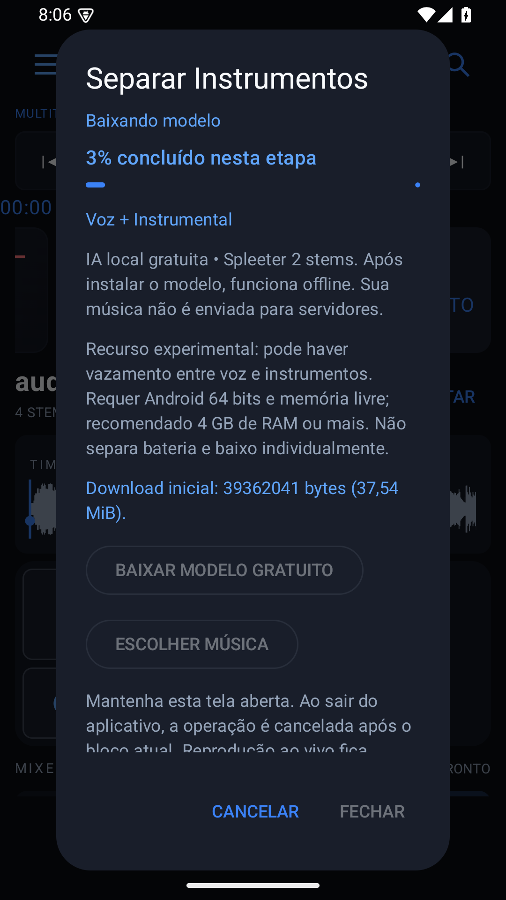

# ATMyTrack 0.15.1 (26) — pacote original e instalação do modelo

18/10/2026. Entrega somente o APK normal **ATMyTrack**, pacote `com.atmytrack.app`. A variante `.preview`, sua tarefa de exportação e sua geração pelo script de build foram removidas. Os artefatos 0.15.0 já existentes são históricos; nenhum APK paralelo novo é publicado nesta entrega.

## Percentual real

- O diálogo exibe o número **“N% concluído nesta etapa”** junto da barra, com status e Cancelar sempre visíveis.
- **Baixando modelo:** bytes efetivamente recebidos/retidos sobre o total de 39.362.041 bytes, mantendo retomada.
- **Verificando integridade — arquivo 1/2 e 2/2:** percentual dos bytes lidos para SHA-256. O hash só é aceito quando corresponde ao manifesto fixado. Ler 100% de um arquivo corrompido não significa instalá-lo.
- **Instalando arquivos do modelo:** quantidade de arquivos efetivamente publicados sobre os dois necessários.
- A mensagem final **“Modelo instalado • 100% • disponível offline”** só é emitida após conferir ambos os hashes, publicar os arquivos e salvar a versão instalada. Cada etapa tem seu próprio percentual; não é previsão de tempo ou percentual global artificial.
- Etapas sem progresso mensurável continuam indeterminadas. Não foram alterados modelo, pesos, inferência, formatos de projeto ou motor do mixer.

## Validação executada

- Build debug nas três ABIs e lint concluídos sem erros. Versão 0.15.1, código 26; `aapt` confirmou pacote `com.atmytrack.app` e nome **ATMyTrack**.
- **57 testes JVM, zero falhas**, incluindo teste novo da verificação de integridade: progresso entre 0 e 100 a partir dos bytes reais, valores intermediários crescentes e rejeição de hash incorreto mesmo após completar a leitura.
- **Dois testes Android, zero falhas, 54,382 s**, no emulador Android 15/API 35 x86_64 (host Windows, Ryzen AI 9 465, 32 GB; emulador 6 GiB/quatro vCPUs).
- O teste de interface fez download real pelo diálogo de confirmação, verificou percentual numérico intermediário visível, Cancelar visível, mensagem final 100%, SHA-256 de ambos os modelos e versão gravada. Foram observadas 60 atualizações de estado. Os pesos anteriormente existentes no emulador foram preservados/restaurados pelo teste.
- A integração foi repetida com dois exemplos musicais em modo avião: inferência real, stems com frames/alinhamento comuns e reconstrução da origem, prévia, importação em projeto novo/atual, reprodução no mixer, persistência, cancelamento, interrupção do processo privado e modelo corrompido. A fixture de 5min27s não foi reprocessada integralmente nesta correção; o núcleo permanece igual à [validação anterior](REPORT-0.15.0.md).
- Atualização `adb install -r` de **0.15.0 normal → 0.15.1 normal**, ambas com a chave deste computador, executada com sucesso. O arquivo `library.json` manteve o SHA-256 **`0f2f19c994688e5fc0e02c5539240e5785cb148d43857f9d8b55cd9e2ef89fa7`** antes e imediatamente depois da atualização, sem desinstalar o aplicativo.
- Não houve validação em aparelho físico nem novas medições de qualidade musical, memória ou temperatura nesta correção. Não se prometem tempos no celular com base no emulador.

## Pendência que impede atualizar a instalação antiga do celular

Remover o pacote paralelo corrige a identidade da entrega, mas **não substitui a chave de assinatura antiga**.

- Certificado do APK público **0.14.4**: `1f9c8116100c1b13aded62b0c2711e3aa045b60c77bb40f57f5f1a71f77e9c39`.
- Certificado disponível neste computador, confirmado no APK 0.15.1: `656039fc2edf595be9c8e7042b1f7b197ad319042bc8de73ff52c4bd59a3d01c`.

O Android recusa atualizar o pacote antigo com certificado diferente (`INSTALL_FAILED_UPDATE_INCOMPATIBLE`, já testado na entrega anterior). Portanto, **não foi concluída uma atualização compatível com a instalação pública 0.14.4**. É necessário localizar e usar a chave anterior — o usuário informou que talvez esteja no outro PC. Caminho comum: `%USERPROFILE%\.android\debug.keystore` (ou `~/.android/debug.keystore` em Linux/macOS). O arquivo deste computador é a chave nova, não a antiga.

Não desinstale o aplicativo original para contornar a assinatura: isso apagaria os dados privados. Não há migração automática da biblioteca do aplicativo paralelo para o original. O APK desta entrega possui o identificador original e não cria outro aplicativo, mas será recusado sobre a instalação 0.14.4 até ser reassinado com a chave correta.

## Arquivos e entrega

Alterados: `app/build.gradle.kts` (versão e retirada da variante paralela), `ModelStore.kt` (verificação/instalação com progresso), `SeparationService.kt` (etapas e conclusão), `SeparationDialog.kt` (percentual numérico), `SeparationTest.kt`, `tools/build-android.ps1`, README e checksums. Novo `ModelInstallProgressUiTest.kt`, captura e este relatório.

APK: `dist/ATMyTrack-debug.apk`; cópia versionada `dist/ATMyTrack-0.15.1-debug.apk`. SHA-256 nos arquivos `.sha256` correspondentes. Fonte e APK serão publicados na release `v0.15.1`, somente no pacote original.

Logs locais: `verification/build-0.15.1.log`, `progress-test-build-0.15.1.log` e `android-0.15.1.log` (ignorados pelo Git). [Modelo, licenças e arquitetura](SEPARATION-DESIGN.md) permanecem os mesmos.
